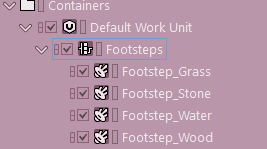
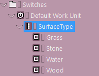
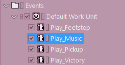

# Audio Integration Task

2423029
Zoe Efstathiou

Build can be found [here](https://github.com/princessbleach/audio-integration-task/tree/main/TaskBuild) under SounsCollector.exe 

#### Wwise

I created a very simple 2d game within Unity to showcase some simple sound implementation with Wwise. The player can move across the map and collect items which in turn play a reward sound and when they read all 10 another celebratory sound is played. The player's footsteps also change sound depending what surface they are on.

Within Wwise I used a Switch and added each surface type: grass, water, stone and wood. I then created a Switch container which had each footstep audio file within it. I then linked these two so that when the player switches between floor types it'll switch between audio files. To add variation to each footstep I used the pitch and LFS randomiser within Wwise and ensured min and max values were not to far apart for a natural/realistic result. 

I also added the other sounds within the actor-mixer hierarchy. Then created Play events for each sound. These events are then called in Unity to trigger the sounds. I also used effects within Wwise such as reverb and delay to slightly tailor sounds to my liking. 

I generated SoundBanks within Wwise and integrated their loading into Unity to make the audio available at runtime. During testing, I encountered an audio playback issue in the standalone build which was resolved by adjusting the Script Execution Order within Unity's project settings. This highlighted the importance of execution order when integrating middleware into a game engine, particularly when initialisation and audio events depend on one another.

In reflection, I would have liked to showcase more Wwise functionalities and perhaps some procedural audio like my previous project however, due to to the build audio issue I ran out of time.

#### Unity

I created FootstepAudio.cs which monitors the players movement and triggers the Play_Footstep event when the player is moving. I adjusted the interval within the inspector to suit the movement of the player. SurfaceDetector.cs detects the surface that the player is stepping on and updates the surface type when collided and triggered. Collectible.cs detects when the player collides with a collectible and triggers the Play_Pickup event - it also communicates with the GameManager to update the collection count. As well as tracking collectibles and triggering Play_Victory sound: this game manager contains the AkBank and AkInitialiser as well as AkAmbient which plays music on awake.  

#### Ai Declaration
AI tools were used to assist with troubleshooting Wwise integration issues within Unity and to help understand errors encountered during development. AI was also used to assist with structuring and refining project documentation and writing gameplay code. 